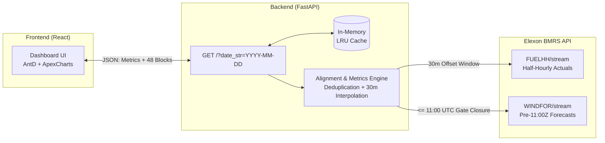

# Energy Forecast Visualization
A energy forecast platform for visualizing data for renewable energy forecasts.

## Tools Utilised
* Backend: FastAPI
* Frontend: React
* External API: Elexon API
* Docker

## Setup
### Prerequisites
* Docker 
* Node.js (v24+) and pnpm
### Environment Variables
Copy the example files before running locally:
```bash
cp client/.env.example client/.env
cp server/.env.example server/.env
```

| File | Variable | Default | Description |
|------|----------|---------|-------------|
| `client/.env` | `VITE_API_URL` | `http://localhost:8000` | Backend URL (baked into Vite bundle at build time) |
| `server/.env` | `ALLOWED_ORIGINS` | `http://localhost:5173` | Comma-separated CORS origins allowed to call the API |


Start all the services using docker compose by running the following command at root:
```bash
docker compose up --build
```
Access the application at:
* Client: `http://localhost:5173`
* Server: `http://localhost:8000`

## Architecture


## Key Project Files
```text
.
├── client/                     # React
│   ├── Dockerfile              # Frontend container configuration
│   └── src/
│   |    ├── types/energy.ts     # TypeScript Response schema
│   |    ├── components/         # KPI Scorecards, Charts, etc.
│   |    └── App.tsx             # Main dashboard & API integration
|   |__README.md                # Other Imp Notes
├── server/                     # FastAPI
│   ├── Dockerfile              # Backend container configuration
│   ├── pyproject.toml          # Python dependencies
│   └── app/
│       ├── main.py             # API routes, LRU caching & Elexon...
│       └── utils/helpers.py    # :30 interpolation & KPI math, etc.
├── compose.yaml                # Multi-container orchestration
└── README.md
```
For frontend Information:  [README.md](client/README.md)


